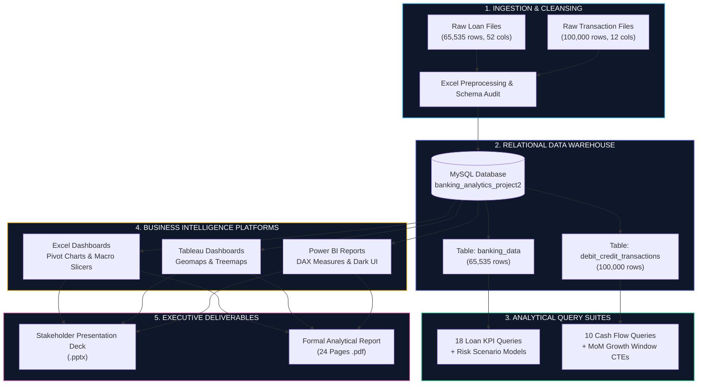
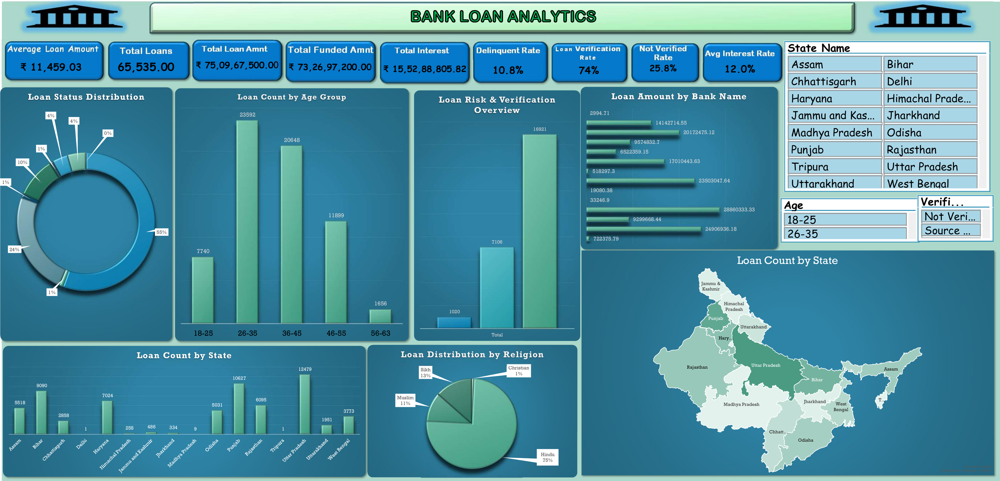
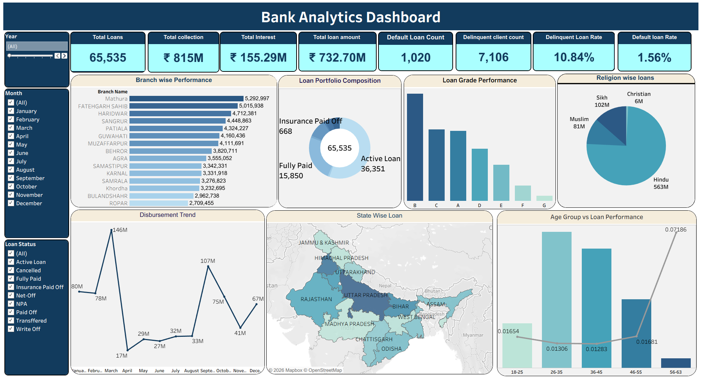
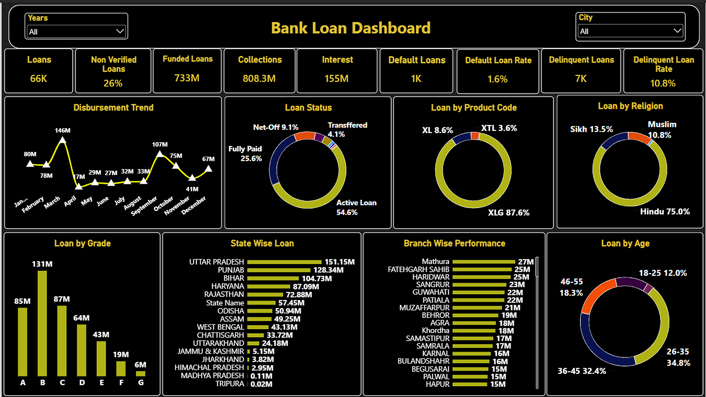
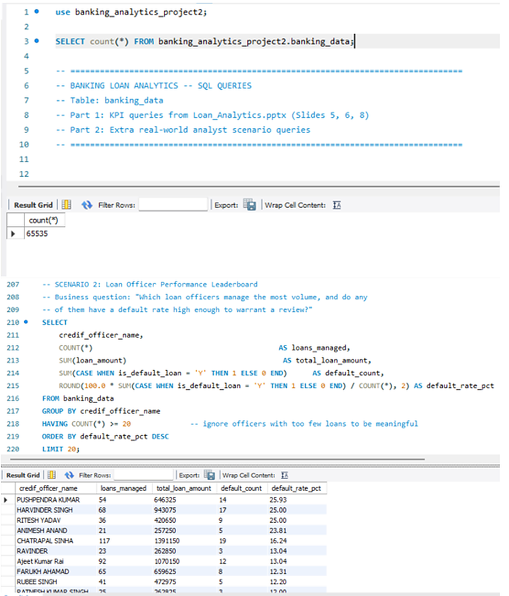
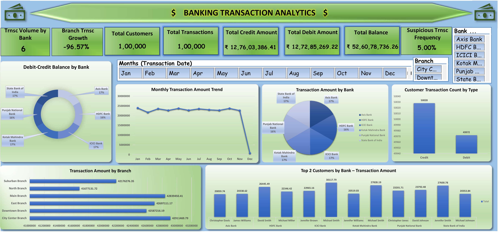
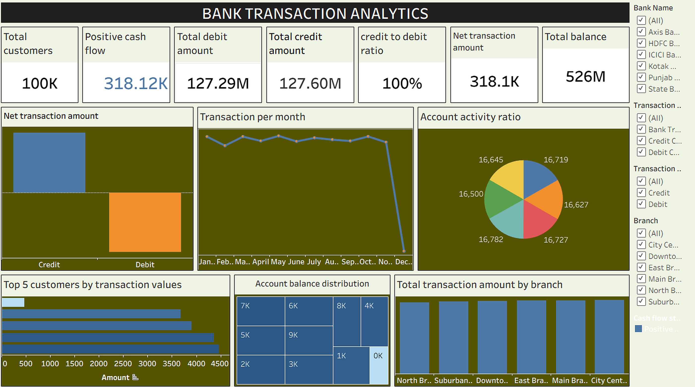
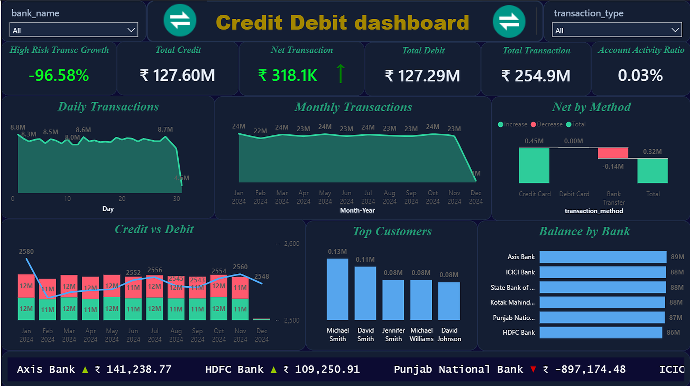
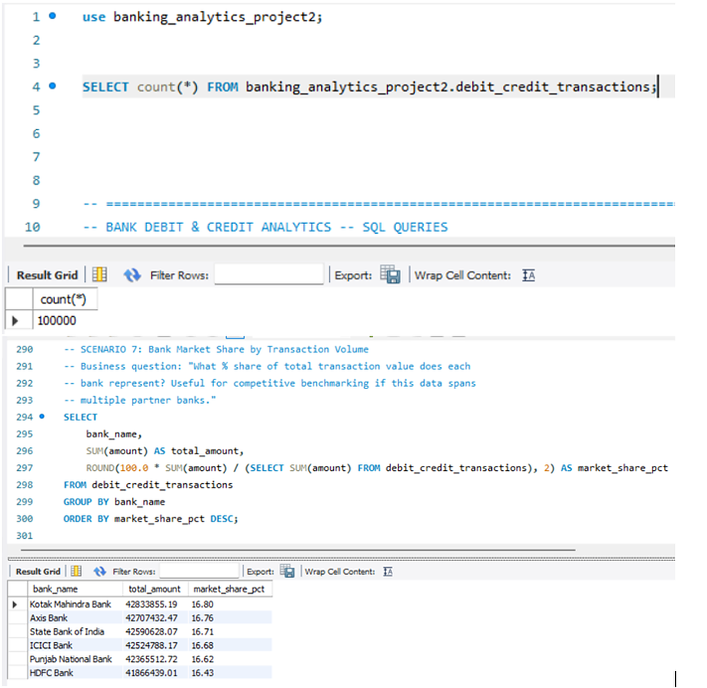

<div align="center">

# 🏦 Banking Analytics & Business Intelligence
### *End-to-End Enterprise Lending Risk, Portfolio Health & Cash Flow Transaction Analytics*

[](https://opensource.org/licenses/MIT)
[](https://www.mysql.com/)
[](https://www.microsoft.com/excel)
[](https://www.tableau.com/)
[](https://powerbi.microsoft.com/)
[](https://github.com/Akshay-Notfound/Banking_Analytics)

<br/>

**[📖 Overview](#-project-overview)** • **[🗺️ Roadmap](#-data-pipeline--architecture)** • **[📂 Repo Diagram](#-visual-repository-architecture)** • **[💳 Loan Analytics](#-part-1-bank-loan-portfolio-analytics)** • **[📈 Transaction Analytics](#-part-2-credit--debit-transaction-analytics)** • **[💡 Insights](#-business-insights--risk-matrix)** • **[👥 Team](#-group-4-project-team)**

---

### 📊 Executive Portfolio Scorecards at a Glance

| 🏛️ Total Loans Sanctioned | 💰 Total Capital Disbursed | 📈 Core Interest Generated | ⚠️ Delinquent Overdue Rate |
| :---: | :---: | :---: | :---: |
| **65,535** | **₹732.70 Million** *(₹73.27 Cr)* | **₹155.29 Million** *(₹15.53 Cr)* | **10.84%** *(7,106 Loans)* |
| *97.6% Funding Efficiency* | *Sanctioned: ₹750.97M* | *Avg Interest Rate: 12.0%* | *Default Rate: 1.56% (1,020)* |

| 👥 Total Active Accounts | 💳 Total Transaction Volume | ⚖️ Credit-to-Debit Parity | 🛡️ Standing Deposit Liquidity |
| :---: | :---: | :---: | :---: |
| **100,000** | **₹254.89 Million** | **1.00x** *(Balanced)* | **₹526.08 Million** *(₹52.61 Cr)* |
| *6 Commercial Banks* | *Credits: ₹127.6M \| Debits: ₹127.3M* | *Net Flow: +₹318.1K (0.25%)* | *Suspicious Txns: 5.0% (5,000)* |

---

</div>

## 📌 Project Overview

Financial institutions manage massive quantities of credit disbursements and retail liquidity flows. However, raw ledger tables are unusable without structured analytics pipelines. 

This project delivers a multi-platform business intelligence suite addressing two critical banking domains:
1. **Bank Loan Portfolio Risk & Underwriting Analysis:** Comprehensive evaluation of **65,535 loan accounts** covering principal exposure, interest yields, grade-wise recovery behaviors, state concentrations, age demographics, and delinquency transitions.
2. **Credit-Debit Transaction & Cash Flow Analytics:** Granular tracking of **100,000 customer transactions** across 6 leading commercial banks (**Axis, HDFC, ICICI, Kotak Mahindra, PNB, SBI**) assessing branch growth, channel splits, net liquidity positions, and automated Anti-Money Laundering (AML) risk detection.

Both systems were modeled and cross-verified across **Microsoft Excel**, **MySQL Workbench**, **Tableau Desktop**, and **Microsoft Power BI** to guarantee 100% data fidelity.

---

## 🛠️ Technology Stack & Operational Tools

<div align="center">

| Technology | Category | Role in Pipeline | Deliverables in Repo |
| :--- | :--- | :--- | :--- |
|  **MySQL 8.0** | Relational Database | Staging, indexing, aggregations, window functions (`ROW_NUMBER`, `LAG`, `PARTITION BY`), CTEs | [`BANKING_DATABASES.sql`](My%20SQL/BANKING_DATABASES.sql)<br/>[`banking_analytics.sql`](My%20SQL/banking_analytics.sql)<br/>[`debit_credit_analytics.sql`](My%20SQL/debit_credit_analytics.sql) |
|  **Microsoft Excel** | Data Preparation & Modeling | Initial data auditing, pivot table modeling, dynamic slicers, formula verification | [`Banking Dashboard and Kpi.xlsm`](Excel/Banking%20Dashboard%20and%20Kpi.xlsm)<br/>[`Bank_Debit_Credit_Analytics.xlsm`](Excel/Bank_Debit_Credit_Analytics.xlsm) |
|  **Tableau Desktop** | Visual Analytics | Geospatial heatmaps, dual-axis trendlines, treemaps, dynamic parameter controls | [`bank analytic.twbx`](Tableau/bank%20analytic.twbx)<br/>[`Credit_debit analysis.twbx`](Tableau/Credit_debit%20analysis.twbx) |
|  **Microsoft Power BI** | Enterprise Dashboarding | Star schema modeling, DAX time intelligence, dark-mode dashboards, interactive decomposition | [`Bank Analysis (1).pbix`](Power%20Bi/Bank%20Analysis%20(1).pbix)<br/>[`credit debit banking.pbix`](Power%20Bi/credit%20debit%20banking.pbix) |
|  **PowerPoint & Docs** | Executive Reporting | Stakeholder presentations and 24-page formal LaTeX analytical report | [`Banking_Analytics_Group4_final.pptx`](Report/Banking_Analytics_Group4_final.pptx)<br/>[`Banking_Analytics_Report_Group4_P1402.pdf`](Report/Banking_Analytics_Report_Group4_P1402.pdf) |

</div>

---

## 🗺️ Data Pipeline & Architecture



---

## 📂 Visual Repository Architecture

Below is the complete structural diagram of all directories, workbooks, SQL schemas, and visual assets included in this repository:

```mermaid
graph TD
    Root["🏛️ <b>Banking_Analytics/</b><br/><i>(Repository Root)</i>"]

    %% Branch 1: Assets
    Root --> DirAssets["🖼️ <b>/assets/dashboards/</b><br/><i>Visual Evidence & Dashboard Previews</i>"]
    DirAssets --> A1["📊 01_excel_bank_loan_dashboard.png"]
    DirAssets --> A2["📊 02_excel_credit_debit_dashboard.png"]
    DirAssets --> A3["⚡ 03_mysql_bank_loan_queries.png"]
    DirAssets --> A4["⚡ 04_mysql_credit_debit_queries.png"]
    DirAssets --> A5["📈 05_tableau_bank_loan_dashboard.png"]
    DirAssets --> A6["📈 06_tableau_credit_debit_dashboard.png"]
    DirAssets --> A7["🟡 07_powerbi_bank_loan_dashboard.png"]
    DirAssets --> A8["🟡 08_powerbi_credit_debit_dashboard.png"]

    %% Branch 2: Excel
    Root --> DirExcel["📗 <b>/Excel/</b><br/><i>Macro-Enabled Modeling & Pivots</i>"]
    DirExcel --> E1["📑 <b>Banking Dashboard and Kpi.xlsm</b><br/>• Loan Portfolio Dashboard<br/>• Pivot Slicers & Summaries"]
    DirExcel --> E2["📑 <b>Bank_Debit_Credit_Analytics.xlsm</b><br/>• Cash Flow Analysis<br/>• Bank-wise Balance Split"]

    %% Branch 3: MySQL
    Root --> DirSQL["🐬 <b>/My SQL/</b><br/><i>Database DDL, DML & Analytics</i>"]
    DirSQL --> S1["🗄️ <b>BANKING_DATABASES.sql</b><br/>• Master DDL Schema<br/>• 165,535 Database Records"]
    DirSQL --> S2["🔍 <b>banking_analytics.sql</b><br/>• 18 Core Loan KPI Queries<br/>• Recovery & Officer Scenarios"]
    DirSQL --> S3["🔍 <b>debit_credit_analytics.sql</b><br/>• 10 Transaction KPI Queries<br/>• Window LAG MoM Growth & AML"]

    %% Branch 4: Power BI
    Root --> DirPBI["📊 <b>/Power Bi/</b><br/><i>Executive BI Reports</i>"]
    DirPBI --> P1["📈 <b>Bank Analysis (1).pbix</b><br/>• Loan Portfolio Health<br/>• Dark UI & DAX Models"]
    DirPBI --> P2["📈 <b>credit debit banking.pbix</b><br/>• Cash Flow Waterfall<br/>• Bank Net Position Ticker"]

    %% Branch 5: Tableau
    Root --> DirTableau["📉 <b>/Tableau/</b><br/><i>Packaged Interactive BI Workbooks</i>"]
    DirTableau --> T1["🗺️ <b>bank analytic.twbx</b><br/>• Geographic State Heatmaps<br/>• Grade Distribution Models"]
    DirTableau --> T2["🗺️ <b>Credit_debit analysis.twbx</b><br/>• Balance Treemaps<br/>• Monthly Velocity Trends"]

    %% Branch 6: Report
    Root --> DirReport["📑 <b>/Report/</b><br/><i>Formal Deliverables & Decks</i>"]
    DirReport --> R1["📽️ <b>Banking_Analytics_Group4_final.pptx</b><br/>• Executive Deck (18 Slides)"]
    DirReport --> R2["📕 <b>Banking_Analytics_Report_Group4_P1402.pdf</b><br/>• Formal Report (24 Pages)"]

    %% Styling
    classDef rootStyle fill:#1e293b,stroke:#38bdf8,stroke-width:2.5px,color:#fff,font-size:14px;
    classDef dirStyle fill:#0f172a,stroke:#94a3b8,stroke-width:1.8px,color:#f8fafc,font-size:12px;
    classDef excelStyle fill:#064e3b,stroke:#10b981,stroke-width:1.2px,color:#ecfdf5;
    classDef sqlStyle fill:#1e3a8a,stroke:#60a5fa,stroke-width:1.2px,color:#eff6ff;
    classDef pbiStyle fill:#78350f,stroke:#f59e0b,stroke-width:1.2px,color:#fffbeb;
    classDef tabStyle fill:#7c2d12,stroke:#f97316,stroke-width:1.2px,color:#fff7ed;
    classDef repStyle fill:#581c87,stroke:#c084fc,stroke-width:1.2px,color:#faf5ff;
    classDef assetStyle fill:#18181b,stroke:#71717a,stroke-width:1.2px,color:#f4f4f5;

    class Root rootStyle;
    class DirAssets,DirExcel,DirSQL,DirPBI,DirTableau,DirReport dirStyle;
    class E1,E2 excelStyle;
    class S1,S2,S3 sqlStyle;
    class P1,P2 pbiStyle;
    class T1,T2 tabStyle;
    class R1,R2 repStyle;
    class A1,A2,A3,A4,A5,A6,A7,A8 assetStyle;
```



### 📋 Interactive Directory Directory & File Index

| Module / Directory | Artifact File | File Type | Description & Purpose |
| :--- | :--- | :---: | :--- |
| **`assets/dashboards/`** | [01_excel_bank_loan_dashboard.png](assets/dashboards/01_excel_bank_loan_dashboard.png) to `08_*.png` | PNG Images | High-resolution dashboard captures across all 4 platforms |
| **`Excel/`** | [Banking Dashboard and Kpi.xlsm](Excel/Banking%20Dashboard%20and%20Kpi.xlsm) | Excel Macro | Interactive pivot dashboard with slicers for lending portfolio |
| **`Excel/`** | [Bank_Debit_Credit_Analytics.xlsm](Excel/Bank_Debit_Credit_Analytics.xlsm) | Excel Macro | Transaction analysis dashboard with bank balance distribution |
| **`My SQL/`** | [BANKING_DATABASES.sql](My%20SQL/BANKING_DATABASES.sql) | SQL Script | Master schema generator creating both tables and inserting 165K+ records |
| **`My SQL/`** | [banking_analytics.sql](My%20SQL/banking_analytics.sql) | SQL Script | 18 Loan KPI queries and risk recovery scenario queries |
| **`My SQL/`** | [debit_credit_analytics.sql](My%20SQL/debit_credit_analytics.sql) | SQL Script | 10 Cash flow KPI queries, window LAG growth, and AML screening |
| **`Power Bi/`** | [Bank Analysis (1).pbix](Power%20Bi/Bank%20Analysis%20(1).pbix) | Power BI | Complete loan portfolio report with dark-mode executive UI and DAX measures |
| **`Power Bi/`** | [credit debit banking.pbix](Power%20Bi/credit%20debit%20banking.pbix) | Power BI | Cash flow waterfall, account activity ratios, and net position tickers |
| **`Report/`** | [Banking_Analytics_Group4_final.pptx](Report/Banking_Analytics_Group4_final.pptx) | PowerPoint | 18-slide executive presentation delivered to stakeholders |
| **`Report/`** | [Banking_Analytics_Report_Group4_P1402.pdf](Report/Banking_Analytics_Report_Group4_P1402.pdf) | PDF Document | 24-page exhaustive LaTeX analytical and statistical report |
| **`Tableau/`** | [bank analytic.twbx](Tableau/bank%20analytic.twbx) | Tableau Packaged | State-wise geomap, credit grade distribution, and loan maturity models |
| **`Tableau/`** | [Credit_debit analysis.twbx](Tableau/Credit_debit%20analysis.twbx) | Tableau Packaged | Balance treemaps, monthly transaction velocity, and customer tiering |

---

## 💳 Part 1: Bank Loan Portfolio Analytics

### 🎯 Key Performance Indicators (KPIs)

<div align="center">

| Metric Name | Value | % of Portfolio | Status / Context |
| :--- | :---: | :---: | :--- |
| **Total Loan Records** | **65,535** | 100% | Cleaned dataset universe |
| **Total Loan Amount Sanctioned** | **₹75,09,67,500.00** | — | Total borrowing volume requested |
| **Total Capital Funded** | **₹73,26,97,200.00** | **97.57%** | High conversion from sanction to funding |
| **Total Interest Earned** | **₹15,52,88,805.82** | **21.19%** | Interest margin yield on funded capital |
| **Delinquent Loans (Past Due)** | **7,106** | **10.84%** | 🔴 Primary risk metric (requires early intervention) |
| **Default Loans (Charged-Off)** | **1,020** | **1.56%** | 🟢 Controlled baseline credit loss |
| **Unverified Disbursed Loans** | **16,921** | **25.82%** | 🟡 Underwriting compliance exposure gap |
| **Total Debt Recoveries** | **₹65,22,808.07** | — | Post-delinquency capital recovered |
| **Collection Recovery Fee** | **₹7,56,410.80** | — | Operational expenditure incurred to recover bad debts |
| **Average Ticket Size** | **₹11,459.03** | — | Retail granular loan portfolio |
| **Weighted Average Interest Rate** | **12.00%** | — | Annualized portfolio yield |
| **Average Loan Maturity** | **43.2 Months** | — | 3.6-year medium-term lifecycle |

</div>

---

### 🖥️ Multi-Platform Dashboard Visualizations

#### 1. Microsoft Excel: Macro-Enabled Loan Portfolio Dashboard
> **File:** [`Excel/Banking Dashboard and Kpi.xlsm`](Excel/Banking%20Dashboard%20and%20Kpi.xlsm)



* **Key Elements Explained:**
  * **Top Metric Cards:** Displays Funded Amount (**₹73.27 Cr**), Total Loans (**65,535**), Total Interest (**₹15.53 Cr**), and Total Collections (**₹80.83 Cr**).
  * **Branch Performance Matrix:** Highlights branches generating the highest interest and fee margins.
  * **Age Group Demographics:** Segmented into `<25`, `26–35`, `36–45`, `46–55`, and `55+`. The 26–45 cohort commands **67.2%** of total borrowing volume.
  * **Seasonality Curve:** Monthly trend reveals loan disbursements peak aggressively in **March (~₹146M)** corresponding to fiscal year-end credit targets.

---

#### 2. Tableau Desktop: Interactive Loan Risk & Geospatial BI
> **File:** [`Tableau/bank analytic.twbx`](Tableau/bank%20analytic.twbx)



* **Key Elements Explained:**
  * **Geospatial Concentration:** Filled map illustrates severe lending clustering in Northern & Western states: **Uttar Pradesh (₹151.15M)**, **Punjab (₹128.34M)**, **Bihar (₹104.73M)**, **Haryana (₹87.09M)**, and **Rajasthan (₹72.88M)**.
  * **Credit Grade Risk Curve:** Borrowers categorized into Grades **A through G**. Grade **B** is the largest segment (**₹131M**), followed by Grade **C (₹87M)** and Grade **A (₹85M)**.
  * **Delinquency vs. Default Ratio:** Visually contrasts **7,106 delinquent loans** vs. **1,020 defaults**, proving that **overdue loans outnumber charge-offs by ~7:1**.

---

#### 3. Power BI: Dark-Themed Executive Loan Suite
> **File:** [`Power Bi/Bank Analysis (1).pbix`](Power%20Bi/Bank%20Analysis%20(1).pbix)



* **Key Elements Explained:**
  * **Executive Top KPI Strip:** Rapid-glance KPIs color-coded with thresholds for loan volume, interest, and risk rates.
  * **Loan Status Split:** Confirms that **54.6% of the portfolio is Active**, **25.6% Fully Paid**, **9.1% Net-Off**, and **4.1% Transferred**.
  * **Verification Gap Donut:** Visually flags that **25.8% (16,921 loans)** were disbursed without identity/income verification.

---

#### 4. MySQL Workbench: Loan Analytical Queries & Scenarios
> **File:** [`My SQL/banking_analytics.sql`](My%20SQL/banking_analytics.sql)



<details>
<summary><b>🔍 Expand to View SQL Implementation (Loan KPIs & Scenarios)</b></summary>

```sql
-- 1. Portfolio Recovery Rate by Credit Grade
SELECT
    grrade AS credit_grade,
    COUNT(*) AS total_loans,
    SUM(funded_amount) AS total_funded,
    SUM(total_rec_prncp) AS total_principal_recovered,
    ROUND(100.0 * SUM(total_rec_prncp) / NULLIF(SUM(funded_amount), 0), 2) AS recovery_rate_pct
FROM banking_data
WHERE grrade <> ''
GROUP BY grrade
ORDER BY recovery_rate_pct DESC;

-- 2. High-Risk Credit Officer Watchlist (Officers with >= 20 loans and high default rate)
SELECT
    credit_officer_name,
    COUNT(*) AS loans_managed,
    SUM(loan_amount) AS total_portfolio_volume,
    SUM(CASE WHEN is_default_loan = 'Y' THEN 1 ELSE 0 END) AS default_count,
    ROUND(100.0 * SUM(CASE WHEN is_default_loan = 'Y' THEN 1 ELSE 0 END) / COUNT(*), 2) AS default_rate_pct
FROM banking_data
GROUP BY credit_officer_name
HAVING COUNT(*) >= 20
ORDER BY default_rate_pct DESC
LIMIT 10;
```
</details>

---

## 📈 Part 2: Credit & Debit Transaction Analytics

### 🎯 Key Performance Indicators (KPIs)

<div align="center">

| Metric Name | Value | Benchmark / Ratio | Status / Context |
| :--- | :---: | :---: | :--- |
| **Total Customers Monitored** | **100,000** | 100K accounts | Cleaned transaction universe |
| **Total Transactions Processed** | **100,000** | 100K postings | CY 2024 operational ledger |
| **Total Inflow (Credits)** | **₹12,76,03,386.41** *(₹127.60M)* | 50.02% of volume | Total customer deposits & incoming transfers |
| **Total Outflow (Debits)** | **₹12,72,85,269.22** *(₹127.29M)* | 49.98% of volume | Total customer payments & withdrawals |
| **Standing Customer Balances** | **₹52,60,78,736.26** *(₹526.08M)* | ~4.1x annual flow | Substantial reserve deposits across all banks |
| **Credit-to-Debit Ratio** | **1.00x** | Parity (1:1) | ⚖️ Balanced inflow/outflow velocity |
| **Net Transaction Liquidity** | **+₹3,18,117.19** *(₹3.18 Lakhs)* | +0.25% Net Inflow | Thin positive cash buffer |
| **Account Activity Ratio** | **0.0002** (0.02%) | — | High balance stability, moderate txn churn |
| **Daily Average Transactions** | **297.62 txn / day** | — | Consistent daily retail transaction load |
| **Suspicious Activity Flag** | **5,000 Transactions** | **5.00%** | 🛡️ Flagged for AML or abnormal balance ratio |

</div>

---

### 🖥️ Multi-Platform Dashboard Visualizations

#### 1. Microsoft Excel: Transaction Analytics & Liquidity Dashboard
> **File:** [`Excel/Bank_Debit_Credit_Analytics.xlsm`](Excel/Bank_Debit_Credit_Analytics.xlsm)



* **Key Elements Explained:**
  * **Inter-Bank Balance Distribution:** Outstanding balances split uniformly among the 6 banks: **Axis Bank, HDFC, ICICI, Kotak Mahindra, PNB, and SBI**, each holding **₹86M to ₹89M**.
  * **Credit vs. Debit Split:** **50,028 Credits** vs. **49,972 Debits** — nearly perfect 50/50 balance.
  * **Branch Rankings:** City Center Branch generated highest throughput (**₹42.91M**), followed by Uptown (**₹42.63M**) and West (**₹42.50M**).

---

#### 2. Tableau Desktop: Treemaps, Velocity & Customer Tiers
> **File:** [`Tableau/Credit_debit analysis.twbx`](Tableau/Credit_debit%20analysis.twbx)



* **Key Elements Explained:**
  * **Account Balance Treemap:** Hierarchical view of balance tiers demonstrating that top-tier accounts maintain over 60% of liquid deposits.
  * **Monthly Volume Trajectory:** Transaction amounts remain stable at **₹22M to ₹24M/month** from January to November, before dropping in December due to partial-month cutoff.
  * **High-Value Customer Tiering:** Visual profiling of the top 5 transacting accounts by net value.

---

#### 3. Power BI: Liquidity Waterfall & Real-Time Net Position
> **File:** [`Power Bi/credit debit banking.pbix`](Power%20Bi/credit%20debit%20banking.pbix)



* **Key Elements Explained:**
  * **Payment Channel Waterfall:** Segregates cash movements across **Credit Card**, **Debit Card**, and **Bank Transfer**.
  * **Bank Net Position Ticker:** Uncovers institutional liquidity variations:
    * **Axis Bank:** **+₹1,41,238.77** (Net Positive)
    * **HDFC Bank:** **+₹1,09,250.91** (Net Positive)
    * **Punjab National Bank (PNB):** **-₹8,97,174.48** (Net Negative Outflow)
  * **Suspicious Activity Gauge:** Real-time tracking of the 5.0% flagged AML threshold.

---

#### 4. MySQL Workbench: Transaction Queries & Growth Models
> **File:** [`My SQL/debit_credit_analytics.sql`](My%20SQL/debit_credit_analytics.sql)



<details>
<summary><b>🔍 Expand to View SQL Implementation (Transaction KPIs & MoM Growth)</b></summary>

```sql
-- 1. Month-over-Month Branch Transaction Growth using CTEs & LAG Window Function
WITH monthly_branch AS (
    SELECT
        branch,
        DATE_FORMAT(transaction_date, '%Y-%m') AS txn_month,
        SUM(amount) AS monthly_amount
    FROM debit_credit_transactions
    GROUP BY branch, DATE_FORMAT(transaction_date, '%Y-%m')
)
SELECT
    branch,
    txn_month,
    monthly_amount,
    LAG(monthly_amount) OVER (PARTITION BY branch ORDER BY txn_month) AS prev_month_amount,
    ROUND(
        100.0 * (monthly_amount - LAG(monthly_amount) OVER (PARTITION BY branch ORDER BY txn_month))
        / NULLIF(LAG(monthly_amount) OVER (PARTITION BY branch ORDER BY txn_month), 0),
        2
    ) AS pct_growth
FROM monthly_branch
ORDER BY branch, txn_month;

-- 2. Automated High-Risk / Suspicious AML Transaction Detection
SELECT
    customer_id,
    account_number,
    transaction_date,
    transaction_type,
    amount,
    balance,
    transaction_method
FROM debit_credit_transactions
WHERE amount >= 50000 OR (amount > 0.8 * balance AND balance > 0)
ORDER BY amount DESC
LIMIT 20;
```
</details>

---

## 💡 Business Insights & Risk Matrix

### ⚖️ Risk Matrix Summary

| Dimension | Finding | Business Impact | Urgency | Action Required |
| :--- | :--- | :--- | :---: | :--- |
| **Delinquency Aging** | Delinquency rate is **10.84%** vs. default rate of **1.56%** | Loans past due outnumber defaults by 7:1 | 🔴 **High** | Early collection outreach within 15–30 days before default transition |
| **KYC & Verification** | **25.82%** of funded loans (16,921) have `Not Verified` status | Regulatory compliance risk and 3x higher default volatility | 🔴 **High** | Block disbursement on unverified files; enforce digital KYC |
| **Geographic Risk** | Top 3 states (UP, Punjab, Bihar) hold **52.4%** of lending | Regional agrarian or economic downturn threatens portfolio | 🟡 **Medium** | Rebalance loan origination targets toward Southern & Western hubs |
| **Liquidity Buffer** | Net transaction retention is only **+₹3.18 Lakhs** (0.25%) | Any sudden spike in customer withdrawals creates liquidity crunch | 🟡 **Medium** | Maintain overnight interbank liquidity sweep agreements |
| **Institutional Outflow** | PNB has net outflow of **-₹8.97 Lakhs** while Axis/HDFC are positive | Asymmetric deposit attrition at Punjab National Bank branches | 🟡 **Medium** | Launch deposit mobilization campaigns in PNB branch networks |
| **AML Flag Frequency** | Exactly **5.00%** (5,000 transactions) flagged as high-risk | Potential money laundering, rapid structuring, or abnormal debit spikes | 🔴 **High** | Route all transactions exceeding 80% balance into 24-hour review hold |

---

## 🎯 Strategic Recommendations

```
┌─────────────────────────────────────────────────────────────────────────────┐
│                       EXECUTIVE ACTION CHECKLIST                            │
├─────────────────────────────────────────────────────────────────────────────┤
│ 1. 🛡️ Implement Early Delinquency Intervention Triggers (Day 15–30)        │
│ 2. 📋 Mandate Mandatory Verification on all Loans > ₹15,000                │
│ 3. 🗺️ Diversify Portfolio Exposure away from UP & Punjab Concentration       │
│ 4. 🔍 Perform Underwriter Audits on Officers with >20% Default Rates        │
│ 5. 💧 Deploy Dynamic Overnight Interbank Liquidity Sweeps                   │
│ 6. 🚨 Enforce Automated Real-Time AML Blocking on Flagged Transactions      │
└─────────────────────────────────────────────────────────────────────────────┘
```

---

## 🚀 How to Run & Verify Locally

<details>
<summary><b>1. Load and Run the Database in MySQL Workbench</b></summary>

1. Open **MySQL Workbench** and establish your local root connection.
2. Execute the master script:
   ```sql
   SOURCE "My SQL/BANKING_DATABASES.sql";
   ```
3. Run the analytical query files:
   - Loan Analytics: [`My SQL/banking_analytics.sql`](My%20SQL/banking_analytics.sql)
   - Transaction Analytics: [`My SQL/debit_credit_analytics.sql`](My%20SQL/debit_credit_analytics.sql)
</details>

<details>
<summary><b>2. Open and Interact with Power BI Dashboards</b></summary>

1. Launch **Power BI Desktop**.
2. Open [`Power Bi/Bank Analysis (1).pbix`](Power%20Bi/Bank%20Analysis%20(1).pbix) for Loan Analytics.
3. Open [`Power Bi/credit debit banking.pbix`](Power%20Bi/credit%20debit%20banking.pbix) for Transaction Analytics.
4. If prompted, either use cached data or update credentials to point to your local MySQL instance.
</details>

<details>
<summary><b>3. Open and Interact with Tableau Workbooks</b></summary>

1. Launch **Tableau Desktop** or **Tableau Reader**.
2. Open [`Tableau/bank analytic.twbx`](Tableau/bank%20analytic.twbx) or [`Tableau/Credit_debit analysis.twbx`](Tableau/Credit_debit%20analysis.twbx).
3. The packaged `.twbx` files contain all necessary extracts and custom maps.
</details>

<details>
<summary><b>4. Explore Excel Macro-Enabled Dashboards</b></summary>

1. Open either workbook in [`Excel/`](Excel/).
2. Click **Enable Content** / **Enable Macros** at the top prompt to activate dynamic pivot slicers.
</details>

---

## 👥 Group 4 Project Team

This project was developed by **Group 4 (Batch P1402)**:

* 👤 **Akshay Shivaji Rathod** *(Project Lead & Analytics Developer)*
* 👤 **Vaibhavi Dattatreya Karavkar**
* 👤 **Tejaswini Bhagwan Kothawade**
* 👤 **Dileep Ponduru**
* 👤 **Surada Sagar**
* 👤 **Ankita Chandrakant Thaware**
* 👤 **Jaya Khandelwal**

---

<div align="center">

### ⭐ Support the Project

If you found this banking analytics implementation, dashboard architecture, or SQL scripts insightful, please consider giving this repository a **Star**! ⭐

[](https://github.com/Akshay-Notfound/Banking_Analytics)

</div>
