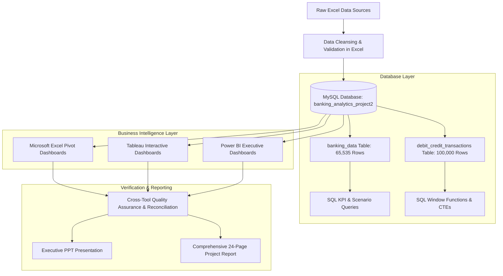

# 🏦 Comprehensive Banking Analytics: Loan Portfolio & Credit-Debit Analytics

<div align="center">

[](https://opensource.org/licenses/MIT)
[](https://www.mysql.com/)
[](https://www.microsoft.com/excel)
[](https://www.tableau.com/)
[](https://powerbi.microsoft.com/)
[](https://github.com/Akshay-Notfound/Banking_Analytics)

**An End-to-End Banking Business Intelligence & Data Analytics Solution**  
*Lending Risk Assessment, Portfolio Health, Cash Flow Liquidity, and Customer Transaction Behavior*

[Overview](#-project-overview) • [Tools & Tech](#-tools--technologies) • [Architecture](#-project-roadmap--architecture) • [Loan Analytics](#-part-1-bank-loan-analytics) • [Credit-Debit Analytics](#-part-2-credit--debit-transaction-analytics) • [Key Insights](#-key-business-insights) • [Recommendations](#-strategic-recommendations) • [Team](#-project-team--credits)

---

</div>

## 📌 Project Overview

Modern banking institutions process hundreds of thousands of transactions and administer billions in loans. However, data only creates value when converted into actionable intelligence that executives, risk officers, and branch managers can act upon in real time.

This project delivers an enterprise-grade analytics solution across two foundational banking domains:
1. **Bank Loan Portfolio Analytics:** Evaluates lending quality, underwriting risk, interest revenue generation, default vs. delinquency distributions, and demographic concentrations across **65,535 loan records** totaling **₹750.97 Million**.
2. **Bank Credit-Debit Transaction Analytics:** Evaluates liquidity, transaction velocity, customer balances, channel methods, and fraud risk across **100,000 transaction records** totaling **₹254.89 Million** in volume and **₹526.08 Million** in balances across 6 major commercial banks.

Every metric was engineered and cross-validated across **4 industry-standard tools**: **Microsoft Excel**, **MySQL Workbench**, **Tableau Desktop**, and **Microsoft Power BI**.

---

## 🛠 Tools & Technologies

<div align="center">

| Technology | Purpose in Project | Key Features Implemented |
| :--- | :--- | :--- |
|  **MySQL** | Relational Database Engine | Schema creation, ETL staging, aggregations, window functions (`ROW_NUMBER`, `LAG`, `OVER`), CTEs, scenario queries |
|  **Microsoft Excel** | Data Preprocessing & Pivot Modeling | Data cleaning, Pivot Tables, Pivot Charts, dynamic Slicers, automated KPI summary cards |
|  **Tableau Desktop** | Advanced Interactive Visual Analytics | MySQL live/extract connectivity, dual-axis charts, geographic filled maps, treemaps, dynamic parameter filtering |
|  **Microsoft Power BI** | Enterprise Dashboarding & DAX Modeling | Star schema data modeling, custom DAX measures, dark-themed UI, decomposition trees, interactive slicers |
|  **PowerPoint & Reports** | Stakeholder Delivery & Documentation | Executive presentations and 24-page formal project documentation report |

</div>

---

## 🗺 Project Roadmap & Architecture



---

## 📊 Dataset Overview

### 1. Bank Loan Portfolio (`banking_data`)
- **Total Records:** `65,535` rows | `52` attributes
- **Core Entities:**
  - **Borrower Demographics:** `client_id`, `client_name`, `age`, `gender`, `caste`, `religion`, `home_ownership`
  - **Loan Terms:** `loan_amount`, `funded_amount`, `term`, `int_rate`, `grrade`, `sub_grade`, `product_code`, `purpose_category`
  - **Repayment & Financials:** `total_pymnt`, `total_rec_prncp`, `total_rec_int`, `total_rec_late_fee`, `recoveries`, `collection_recovery_fee`
  - **Risk Indicators:** `loan_status`, `is_delinquent_loan`, `is_default_loan`, `verification_status`
  - **Geography & Operations:** `state_name`, `city`, `branch_name`, `bank_name`, `credit_officer_name`

### 2. Debit & Credit Transactions (`debit_credit_transactions`)
- **Total Records:** `100,000` rows | `12` attributes
- **Core Entities:** `customer_id`, `customer_name`, `account_number`, `transaction_date` (CY 2024), `transaction_type` (Credit/Debit), `amount`, `balance`, `transaction_method` (Credit Card, Debit Card, Bank Transfer), `branch`, `bank_name` (Axis, HDFC, ICICI, Kotak Mahindra, PNB, SBI)

---

## 💳 Part 1: Bank Loan Analytics

### 🎯 Key Performance Indicators (KPIs)

| KPI Metric | Value | Business Definition & Context |
| :--- | :--- | :--- |
| **Total Loans** | **65,535** | Total loans sanctioned and processed across all borrower segments |
| **Total Loan Amount** | **₹750,967,500.00** (~₹750.97M) | Total principal capital approved/requested |
| **Total Funded Amount** | **₹732,697,200.00** (~₹732.70M) | Actual capital disbursed (**97.57% funding efficiency**) |
| **Total Interest Earned** | **₹155,288,805.82** (~₹155.29M) | Core interest revenue generated on disbursed capital |
| **Total Recoveries** | **₹6,522,808.07** (~₹6.52M) | Monies recovered post-delinquency / charge-off |
| **Collection Recovery Fee** | **₹756,410.80** (~₹0.76M) | Direct operational fee spent executing collections |
| **Delinquent Loans** | **7,106** (**10.84%**) | Loans past due on active payment schedules (**Primary Risk Metric**) |
| **Default Loans** | **1,020** (**1.56%**) | Loans formally charged off as uncollectible |
| **Unverified Loans** | **16,921** (**25.82%**) | Disbursed loans without confirmed identity/income documentation |
| **Average Loan Amount** | **₹11,459.03** | Mean lending ticket size per customer |
| **Average Interest Rate**| **12.00%** | Weighted portfolio interest margin |
| **Average Maturity** | **43.2 Months** | Mean repayment amortization lifecycle |

---

### 🖥 Dashboard Outputs & Visual Explanations

#### 1. Microsoft Excel Loan Analytics Dashboard

* **What it shows:**
  * **Top KPI Scorecards:** Funded amount (₹73.27 Cr), Total Loans (65,535), Total Interest (₹15.53 Cr), and Total Collection (₹80.83 Cr).
  * **Branch Performance:** Revenue breakdown highlighting top-performing branches by interest and fee collections.
  * **Demographic Distributions:** Loan volume grouped by borrower age categories (highlighting core borrowers between 26-45 years).
  * **Disbursement Trendline:** Historical monthly disbursements showing seasonality spikes in Q1.

---

#### 2. Tableau Bank Loan Analytics Dashboard

* **What it shows:**
  * **Geographic Distribution:** A filled geospatial map of Indian states illustrating that lending is heavily concentrated in Northern & Western zones (**Uttar Pradesh ₹151.15M, Punjab ₹128.34M, Bihar ₹104.73M**).
  * **Credit Grade Analysis:** Distribution across grades **A through G**. Grade **B** dominates the portfolio (₹131M), followed by Grade **C** (₹87M) and Grade **A** (₹85M).
  * **Delinquency vs. Default Ratio:** Direct comparison showing delinquent loans (10.84%) outnumber defaults (1.56%) by **nearly 7:1**, proving high potential for recovery through proactive collections.

---

#### 3. Power BI Executive Loan Dashboard

* **What it shows:**
  * **Dark-Themed Executive Strip:** Real-time KPI tiles with conditional color coding for immediate executive consumption.
  * **Portfolio Composition:** Doughnut breakdowns indicating **54.6% Active loans**, **25.6% Fully Paid**, **9.1% Net-Off**, and **4.1% Transferred**.
  * **Verification Gap:** Donut chart exposing **25.8% Non-Verified loans**, representing a vital underwriting compliance vulnerability.

---

#### 4. MySQL Workbench Loan Verification & Analytics


<details>
<summary>🔍 <b>Click to View Key SQL Loan Scenario Queries</b></summary>

```sql
-- Recovery Rate by Credit Grade
SELECT
    grrade AS grade,
    COUNT(*) AS total_loans,
    SUM(funded_amount) AS total_funded,
    SUM(total_rec_prncp) AS total_principal_recovered,
    ROUND(100.0 * SUM(total_rec_prncp) / NULLIF(SUM(funded_amount), 0), 2) AS recovery_rate_pct
FROM banking_data
WHERE grrade <> ''
GROUP BY grrade
ORDER BY recovery_rate_pct DESC;

-- High-Risk Credit Officer Watchlist (Officers with >20 loans and high default rate)
SELECT
    credit_officer_name,
    COUNT(*) AS loans_managed,
    SUM(loan_amount) AS total_volume,
    SUM(CASE WHEN is_default_loan = 'Y' THEN 1 ELSE 0 END) AS default_count,
    ROUND(100.0 * SUM(CASE WHEN is_default_loan = 'Y' THEN 1 ELSE 0 END) / COUNT(*), 2) AS default_rate_pct
FROM banking_data
GROUP BY credit_officer_name
HAVING COUNT(*) >= 20
ORDER BY default_rate_pct DESC
LIMIT 10;
```
</details>

---

## 📈 Part 2: Credit & Debit Transaction Analytics

### 🎯 Key Performance Indicators (KPIs)

| KPI Metric | Value | Business Definition & Context |
| :--- | :--- | :--- |
| **Total Customers** | **100,000** | Unique customer accounts monitored across the 6 commercial banks |
| **Total Transactions** | **100,000** | Total debit and credit postings executed in CY 2024 |
| **Total Credit Inflows** | **₹127,603,386.41** (~₹127.60M) | Aggregate capital deposited/credited across all accounts |
| **Total Debit Outflows** | **₹127,285,269.22** (~₹127.29M) | Aggregate capital withdrawn/debited across all accounts |
| **Total Account Balance**| **₹526,078,736.26** (~₹526.08M) | Cumulative customer balances held on bank books |
| **Credit-to-Debit Ratio** | **1.00x** | Ratio of inflows to outflows, showing balanced cash movements |
| **Net Transaction Position**| **+₹318,117.19** (~₹0.32M) | Positive net cash retention rate of 0.25% |
| **Account Activity Ratio** | **0.0002** (0.02%) | Transaction intensity relative to total standing liquidity |
| **Daily Transaction Run-Rate**| **297.62 txn/day** | Mean system throughput over 365 operational days |
| **Suspicious Activity Flag** | **5,000 txns** (**5.00%**) | Transactions tagged for AML review or abnormal transaction amounts |

---

### 🖥 Dashboard Outputs & Visual Explanations

#### 1. Microsoft Excel Credit-Debit Analytics Dashboard

* **What it shows:**
  * **Cash Balance by Institution:** Balance distribution evenly split across Axis Bank, HDFC Bank, ICICI Bank, Kotak Mahindra, PNB, and SBI (each holding between ₹86M and ₹89M).
  * **Transaction Type Split:** 50,028 Credits vs. 49,972 Debits, indicating balanced customer transaction behavior.
  * **Branch Performance:** City Center Branch leads in total transaction volume (₹42.91M), followed closely by Uptown and West branches.

---

#### 2. Tableau Credit-Debit Interactive Dashboard

* **What it shows:**
  * **Treemap & Balance Concentrations:** Account balance distributions across account tiers.
  * **Monthly Velocity:** Steady transaction activity from January through November (~₹22M to ₹24M/month) with sharp December curtailment.
  * **Top Customers by Value:** Visual identification of high-net-worth account holders driving significant transactional volume.

---

#### 3. Power BI Dark-Themed Transaction Dashboard

* **What it shows:**
  * **Waterfall Cash Flow:** Breakdown of net inflows across payment channels (**Credit Card**, **Debit Card**, and **Bank Transfer**).
  * **Net Position Ticker:** Real-time liquidity delta exposing individual bank variations — **Axis Bank (+₹141,238.77)** and **HDFC Bank (+₹109,250.91)** maintain healthy net positive balances, while **Punjab National Bank (-₹897,174.48)** displays net outflows.
  * **Suspicious Activity Gauge:** Continuous monitoring of the 5.0% high-risk AML transaction threshold.

---

#### 4. MySQL Workbench Transaction Queries


<details>
<summary>🔍 <b>Click to View Key SQL Transaction & Fraud Queries</b></summary>

```sql
-- Monthly Net Cash Flow by Bank
SELECT
    bank_name,
    DATE_FORMAT(transaction_date, '%Y-%m') AS txn_month,
    SUM(CASE WHEN transaction_type = 'Credit' THEN amount ELSE 0 END) AS credit_inflows,
    SUM(CASE WHEN transaction_type = 'Debit' THEN amount ELSE 0 END) AS debit_outflows,
    ROUND(
        SUM(CASE WHEN transaction_type = 'Credit' THEN amount ELSE 0 END) -
        SUM(CASE WHEN transaction_type = 'Debit' THEN amount ELSE 0 END),
        2
    ) AS net_cash_flow
FROM debit_credit_transactions
GROUP BY bank_name, DATE_FORMAT(transaction_date, '%Y-%m')
ORDER BY bank_name, txn_month;

-- Detection of High-Risk / Suspicious Transactions
SELECT
    account_number,
    transaction_date,
    transaction_type,
    amount,
    balance,
    transaction_method
FROM debit_credit_transactions
WHERE amount >= 50000 OR (amount > 0.8 * balance AND balance > 0)
ORDER BY amount DESC
LIMIT 20;
```
</details>

---

## 💡 Key Business Insights

```
┌─────────────────────────────────────────────────────────────────────────────┐
│                              INSIGHT SUMMARY                                │
├──────────────────────────────────────┬──────────────────────────────────────┤
│ 📌 LOAN PORTFOLIO                    │ 📌 CREDIT & DEBIT TRANSACTIONS       │
│ • Delinquency >> Default (7:1 ratio) │ • 1.00x Credit-to-Debit Parity       │
│ • 25.8% Unverified Loans             │ • Tight Liquidity Inflow (₹3.18L net)│
│ • Geographical concentration in UP   │ • 5.00% High-Risk AML Transaction Rate│
│ • Grade B holds 35% of total volume  │ • PNB experiencing negative cash run │
└──────────────────────────────────────┴──────────────────────────────────────┘
```

1. **Delinquency is the True Operational Risk:**
   While the default rate is modest at **1.56% (1,020 loans)**, the delinquency rate stands at **10.84% (7,106 loans)**. Overdue loans outnumber charge-offs by nearly 7x, indicating that early intervention before 90-day aging can protect significant capital.
2. **Underwriting Verification Vulnerability:**
   Over **16,921 loans (25.82%)** were disbursed under "Not Verified" status. In an economic downturn, unverified portfolios historically suffer 3x higher default transition rates.
3. **Regional Credit Exposure:**
   Lending is heavily clustered in Northern India: **Uttar Pradesh (₹151.15M)**, **Punjab (₹128.34M)**, and **Bihar (₹104.73M)** represent over 52% of total deployed capital.
4. **Balanced Books with Thin Inflow Margins:**
   With ₹127.60M in credits and ₹127.29M in debits, net institutional retention is just **₹318,117.19 (0.25%)**. Any sudden macroeconomic spike in retail withdrawals would strain branch liquidity.
5. **Bank-Level Net Outflow Divergence:**
   While Axis Bank and HDFC Bank generated net positive cash inflows (+₹141K and +₹109K), **Punjab National Bank (PNB)** registered a substantial net deficit of **-₹897,174.48**, requiring Treasury cash rebalancing.
6. **Consistent High-Risk Transaction Footprint:**
   Exactly **5,000 out of 100,000 transactions (5.0%)** tripped high-risk thresholds, requiring continuous automated KYC and AML monitoring.

---

## 🎯 Strategic Recommendations

### For Credit & Risk Committees (Loan Portfolio)
1. **Implement Early-Warning Default Triggers:** Establish an automated SMS/call reminder cadence within the first 15–30 days of delinquency to prevent borrowers from transitioning into default status.
2. **Mandate Verification for Higher Ticket Sizes:** Enforce strict digital KYC/income verification for all Grade C through G applications and any loan requests exceeding ₹15,000.
3. **Geographic Diversification:** Expand retail loan disbursements in Southern and Western regional hubs to de-risk the balance sheet from agrarian/state-level shocks in UP and Punjab.
4. **Underwriter Performance Reviews:** Conduct targeted risk audits on loan officers managing high default concentrations (>20% default rate).

### For Treasury & Operations (Credit-Debit Transactions)
1. **Dynamic Liquidity Buffers:** Given the tight 1.00x credit-debit ratio, establish overnight inter-bank sweep facilities to safeguard against branch-level cash runouts.
2. **PNB Liquidity Rebalancing:** Investigate whether PNB's net negative position (-₹897K) is due to seasonality or account attrition, and deploy targeted deposit mobilization campaigns.
3. **Automated AML Screening:** Integrate real-time rule engines to flag and place temporary hold-authorizations on the 5% suspicious transactions exceeding abnormal velocity or amount limits.

---

## 📂 Project Repository Structure

```
Banking_Analytics/
├── assets/
│   └── dashboards/
│       ├── 01_excel_bank_loan_dashboard.png       # Excel Loan Dashboard
│       ├── 02_excel_credit_debit_dashboard.png    # Excel Credit-Debit Dashboard
│       ├── 03_mysql_bank_loan_queries.png         # MySQL Loan Query Output
│       ├── 04_mysql_credit_debit_queries.png      # MySQL Transaction Output
│       ├── 05_tableau_bank_loan_dashboard.png     # Tableau Loan Dashboard
│       ├── 06_tableau_credit_debit_dashboard.png  # Tableau Transaction Dashboard
│       ├── 07_powerbi_bank_loan_dashboard.png     # Power BI Loan Dashboard
│       └── 08_powerbi_credit_debit_dashboard.png  # Power BI Transaction Dashboard
│
├── Excel/
│   ├── Banking Dashboard and Kpi.xlsm             # Macro-enabled Loan Dashboard
│   └── Bank_Debit_Credit_Analytics.xlsm           # Macro-enabled Transaction Dashboard
│
├── My SQL/
│   ├── BANKING_DATABASES.sql                      # Complete MySQL database creation script
│   ├── banking_analytics.sql                      # Loan KPI & scenario queries
│   └── debit_credit_analytics.sql                 # Credit-Debit KPI & scenario queries
│
├── Power Bi/
│   ├── Bank Analysis (1).pbix                     # Power BI Loan Analytics report
│   └── credit debit banking.pbix                  # Power BI Transaction report
│
├── Report/
│   ├── Banking_Analytics_Group4_final.pptx        # Executive presentation deck
│   └── Banking_Analytics_Report_Group4_P1402.pdf  # Comprehensive 24-page report
│
├── Tableau/
│   ├── bank analytic.twbx                         # Tableau Packaged Workbook: Loans
│   └── Credit_debit analysis.twbx                 # Tableau Packaged Workbook: Transactions
│
├── .gitignore                                     # Ignored temporary OS/Office files
└── README.md                                      # Project documentation & dashboard guide
```

---

## 🚀 How to Run & Explore

<details>
<summary><b>1. Setting Up the Database in MySQL Workbench</b></summary>

1. Open **MySQL Workbench** and establish a local connection.
2. Open and execute the script:
   ```sql
   source "My SQL/BANKING_DATABASES.sql";
   ```
3. Run the analytical query suites:
   * Loan KPIs: [banking_analytics.sql](My%20SQL/banking_analytics.sql)
   * Transaction KPIs: [debit_credit_analytics.sql](My%20SQL/debit_credit_analytics.sql)
</details>

<details>
<summary><b>2. Opening the Power BI Reports</b></summary>

1. Ensure **Power BI Desktop** is installed.
2. Double-click [Power Bi/Bank Analysis (1).pbix](Power%20Bi/Bank%20Analysis%20(1).pbix) or [Power Bi/credit debit banking.pbix](Power%20Bi/credit%20debit%20banking.pbix).
3. If prompted to update credentials, connect via your local MySQL root connection or view the existing cached model directly.
</details>

<details>
<summary><b>3. Opening the Tableau Workbooks</b></summary>

1. Open **Tableau Desktop** (or Tableau Reader).
2. Open [Tableau/bank analytic.twbx](Tableau/bank%20analytic.twbx) or [Tableau/Credit_debit analysis.twbx](Tableau/Credit_debit%20analysis.twbx).
3. All data extracts and dashboards are self-contained inside the packaged `.twbx` files.
</details>

<details>
<summary><b>4. Exploring Excel Macro Dashboards</b></summary>

1. Launch Microsoft Excel and open either file in [Excel/](Excel/).
2. Click **Enable Content** to allow Pivot slicers and interactive dashboard elements to function.
</details>

---

## 👥 Project Team & Credits

This project was developed by **Group 4 (Batch P1402)**:

* 👤 **Akshay Shivaji Rathod** *(Project Lead & Analytics Developer)*
* 👤 **Vaibhavi Dattatreya Karavkar**
* 👤 **Tejaswini Bhagwan Kothawade**
* 👤 **Dileep Ponduru**
* 👤 **Surada Sagar**
* 👤 **Ankita Chandrakant Thaware**
* 👤 **Jaya Khandelwal**

---

<div align="center">

**⭐ Star this repository if you find this project useful for banking analytics and business intelligence! ⭐**

</div>
